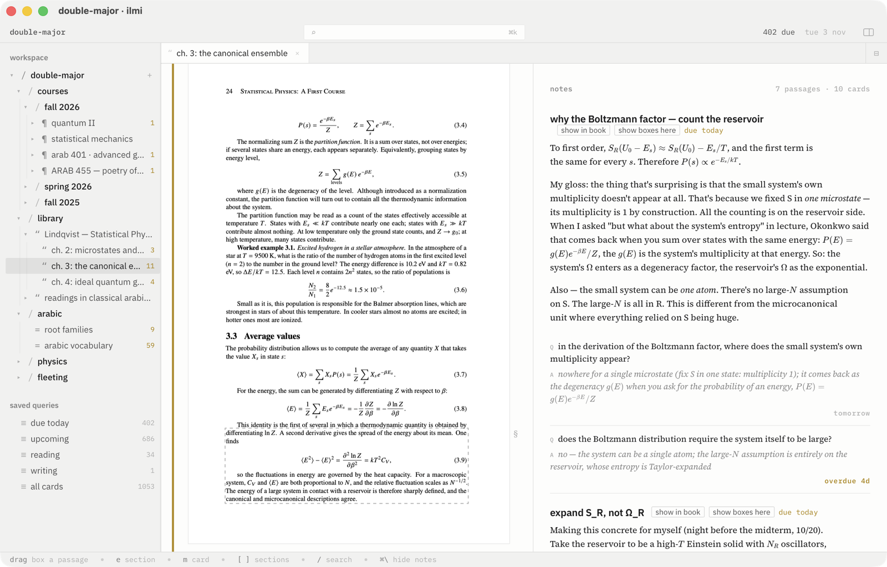
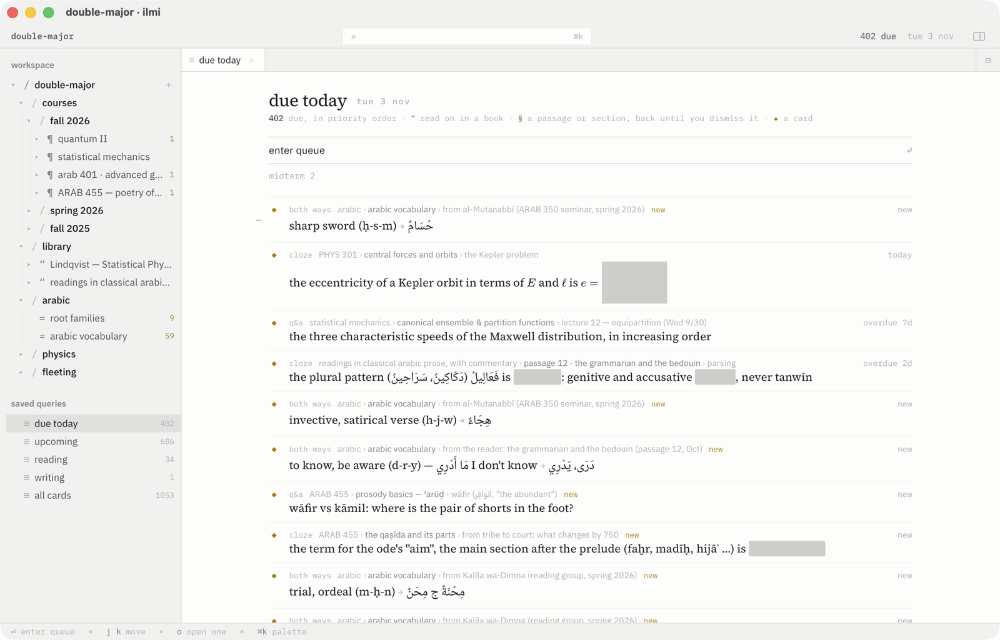
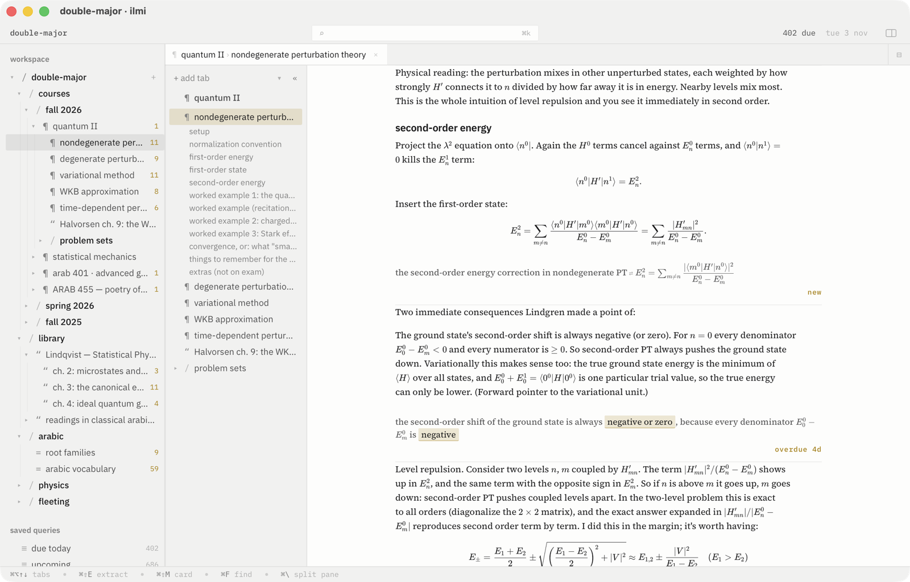
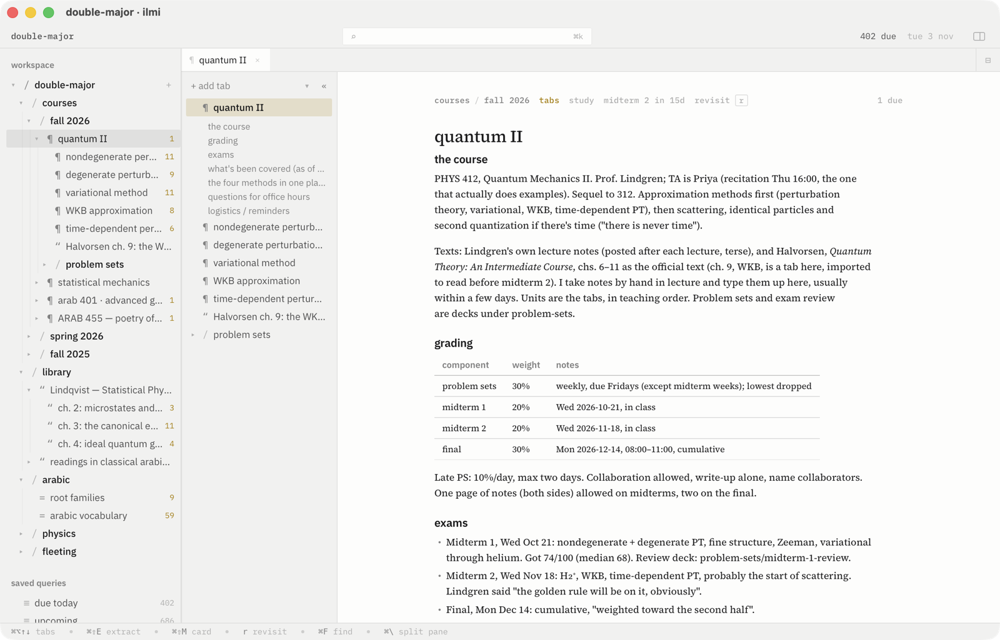
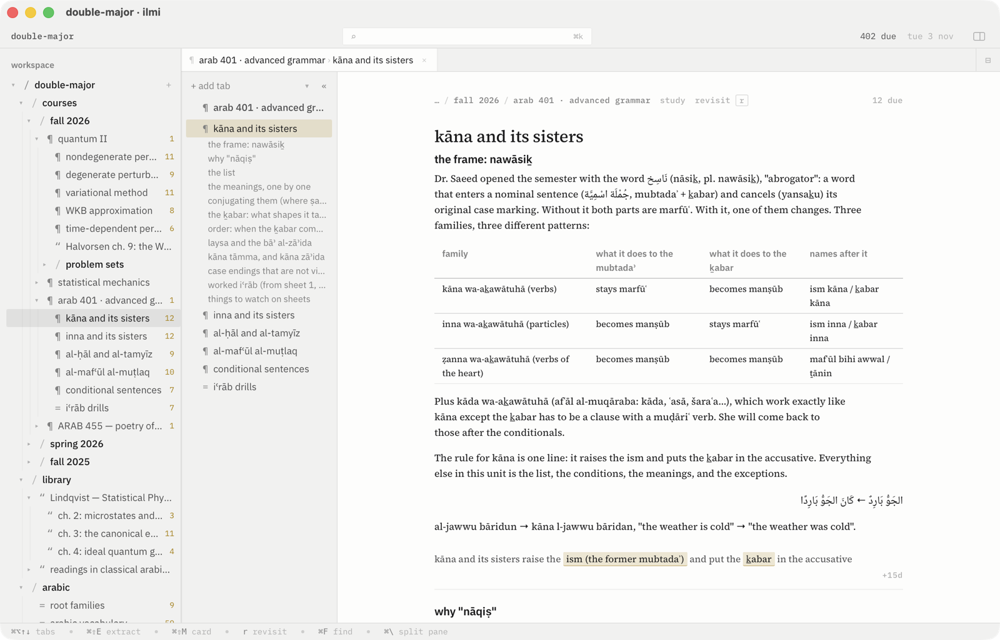
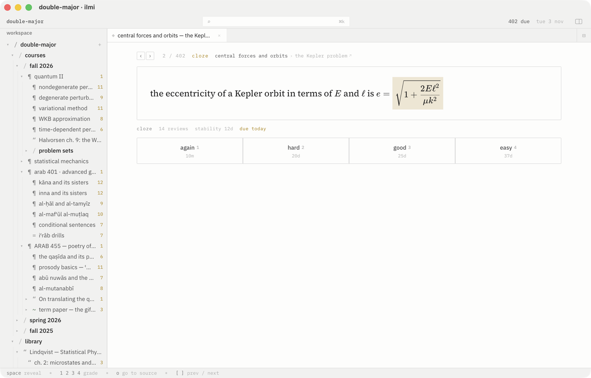
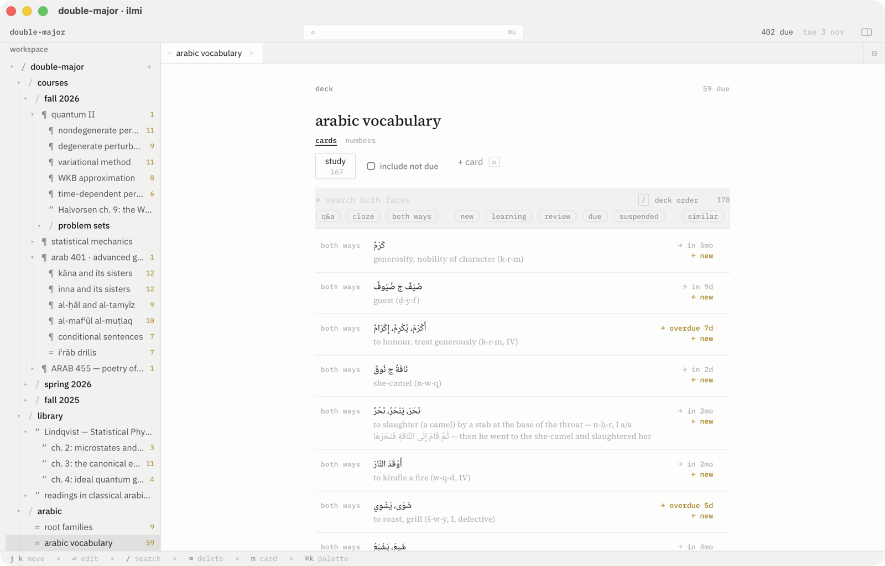
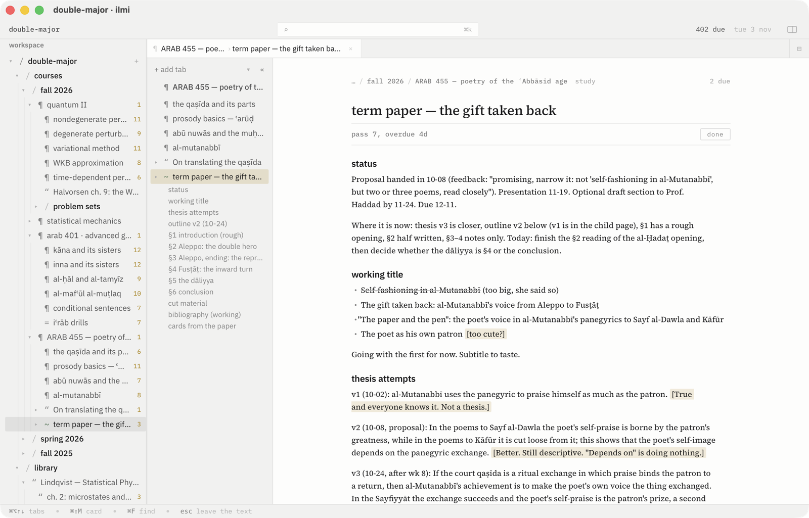
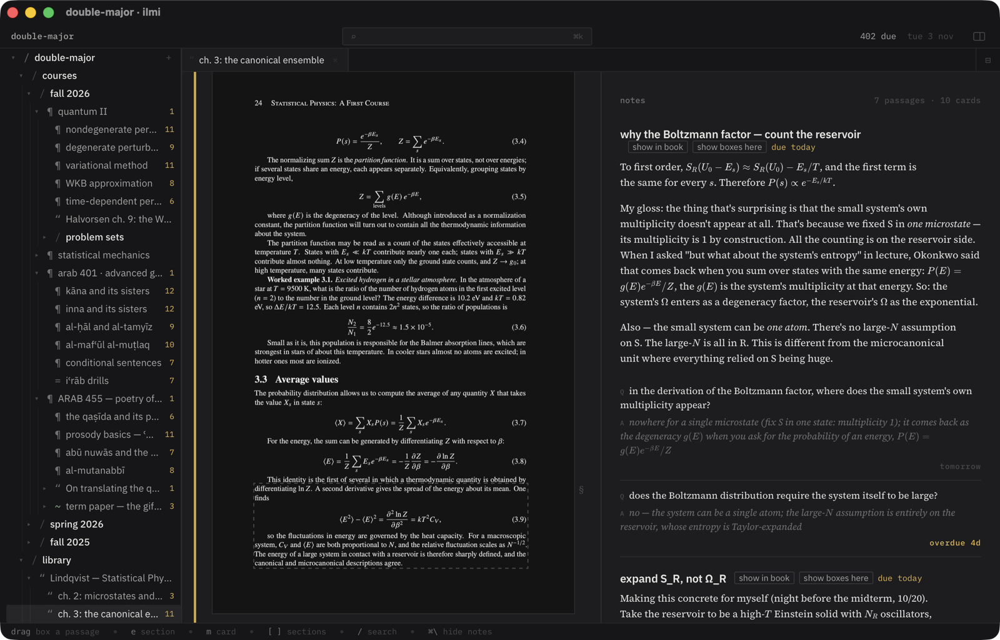

<p align="center"></p>

# ilmi

Incremental reading, spaced-repetition cards, and incremental writing over a
folder of plain Markdown files. The files are the model; the app is a lens.

<p align="center"></p>

You keep a folder of Markdown, as you would for Obsidian or a plain text
editor. ilmi opens it as a *collection* and adds three loops over the files,
each written back as one readable line in the file it belongs to:

- **Reading.** A PDF, a book in EPUB, a clipped web page, or a pasted text is
  a *source*. You read it in passes; a passage you box or select becomes a
  *section* of your notes that comes back on its own schedule, until you
  dismiss it. A source with reading left returns every day, every other day,
  or every third day by its priority, so a textbook gets finished.
- **Cards.** Any line can be a card: `front :: back`, a cloze
  `{{c1::answer}}`, a question with a derivation under it, a blank inside a
  formula. Cards are reviewed with FSRS, the grade written as one comment
  line under the card.
- **Writing.** A *draft* comes back when it is due, grows its interval each
  pass, and is dismissed when it is done. Notes you ask to revisit do the
  same.

One queue holds the day: cards, reading, sections, drafts, sorted by a draw
around each item's priority so the top holds and the middle mixes. A budget
folds the day at as many elements as you have time for.

Everything is Markdown you can read and edit elsewhere: `FORMAT.md` is the
contract, and the app's own annotations are the only lines it ever writes.

## Install

macOS, Apple Silicon and Intel. Download the DMG from the latest release,
open it, and drag ilmi into Applications. The build is not notarized, so the
first launch is refused: open System Settings > Privacy & Security and choose
*Open Anyway* once.

To build it yourself you need node and a Rust toolchain:

```
npm install
npm run tauri build     # src-tauri/target/release/bundle/dmg/ilmi_<version>_aarch64.dmg
npm run tauri dev       # or run it from source
```

Releases are built by `.github/workflows/release.yml` when a `v*` tag is
pushed; `docs/development.md` has the details and the signing secrets.

## The first day

1. **New collection** (⌘⇧N) makes a folder with `start here.md`, one short
   source with a card in it. `Open collection` (⌘O) opens any folder of
   Markdown you already have.
2. **Drop something on the window**: a PDF lands beside a Markdown file for
   your notes on it and opens as a book; an EPUB lands as a notebook with a
   tab per chapter; a `.txt` or `.md` of prose lands as a source; an Anki
   package as decks; a web address pasted (⌘V) is clipped as Markdown with
   its images.
3. **Read.** `r` starts reading a source. Drag on a page or select in the
   text, then `e` makes the passage a section of your notes, `m` makes a
   card from it. ⏎ is *done for today*; the source comes back on its
   cadence.
4. **Write.** A note is a Markdown editor that draws Markdown as Markdown:
   `- dof :: 3N − k` in your class notes is a card beside its bullet, a
   formula is a chip that opens on a click, `/` inserts a heading, a list,
   a table, a cloze.
5. **Work the queue.** `today` in the sidebar lists what is due; ⏎ enters a
   session that walks it. On a card, space reveals and 1–4 grades. On a
   section or a source, ⏎ is next, `p` later, `d` dismiss.
6. **Set priorities** in the inspector (⌘⇧I): 0 first, 100 last, on a
   document or a card. The queue's order follows.

`samples/double-major` is a worked collection, a semester of physics and
Arabic with two typeset books, to open and try.

## Screenshots

| | |
|---|---|
|  |  |
| The day's queue: cards, reading, sections, drafts, one order | A note: formulas as chips, a list item as a card, its schedule a line under it |
|  |  |
| A course document with its notes as tabs | Arabic and English on one page, each block reading its own way |
|  |  |
| A session: the card, its document and headings above it | A deck: one card per row, when each is next |
|  |  |
| A draft that comes back until it is done | The dark theme; there is an e-ink one too |

## How the day is scheduled

- **Cards** follow FSRS (`ts-fsrs`): one `sr` line under the card holds due,
  stability, difficulty, reps, and lapses. An exam date on a course brings
  its cards forward so they are seen before it.
- **A source with reading left** comes back on a cadence by priority: every
  day under 34, every other day to 66, every third day above. The interval
  never grows, so a long book is finished rather than forgotten.
- **Sections, notes revisited, extracts, and drafts** grow: each pass
  multiplies the interval by the item's growth factor (1.6 reading, 1.5
  writing), measured from the time actually elapsed since the pass before,
  so sixty days late on three lands past ninety, not at five.
- **The order** is a draw around each item's priority, the same all day and
  another the next. Postpone (`p`) grows an interval by 1.2; the backlog
  rule only holds a book over to tomorrow.
- **The budget** folds the day at that many elements; `postpone the rest`
  pushes what was due before today and leaves today's alone.

`design/sim/` holds the simulation this was tuned on: at forty-five minutes
a day, three textbooks a semester finish.

## Documentation

- `docs/guide.md`: using the app, from the collection to the queue.
- `docs/keys.md`: every key, by where you are.
- `FORMAT.md`: the on-disk format, the contract any other tool can rely on.
- `PLUGINS.md`: writing, installing, and publishing a plugin; the repo ships
  a sample and a dictionary.
- `docs/development.md`: running from source, the smoke modes, the installer
  and release workflow, the layout of the code.
- `PLAN.md` and `BUILD-LOG.md`: how it was built, milestone by milestone.

## Keys

```
⌘K      palette            ⌘⇧N / ⌘O   new / open collection
⌘W      close tab          ⌘\          split pane
⌃⌘S     sidebar            ⌘⇧I        inspector
⌘,      tweaks             ⌘F          find in a page
r       start reading      e / m       section / card from a selection
space   reveal a card      1 2 3 4     grade it
⏎ p d   next, later, dismiss, in a session
```

The full list, including the editor's and the book's, is `docs/keys.md`.

## Layout

```
src/app/        renderer: React, Zustand store, tokens.css
src/format/     parser and serializer, the only code that touches vault files
src/vault/      open, walk, read, write, watch, and reshape a vault
src/schedule/   FSRS grading, the reading and writing loops, the queue
src/import/     text, pages, card lists, Anki, EPUB, SuperMemo, on their way to files
src/pdf/        the book lens's pure side
src/plugins/    the plugin runtime
src-tauri/      the desktop shell (Tauri v2, Rust); anki.rs and epub.rs read packages
docs/           guide, keys, screenshots, development notes
```

## Status

Version 0.1, built for one person's semester and in daily use. macOS only
for now; the Rust shell has nothing platform-specific beyond one menu item,
but no other platform has been built or tried. Around twelve hundred tests
cover the format, the vault, and the schedule; the window is checked by the
smoke modes in `src/app/smoke.ts`.
