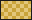

## a sampler of markdown

Plain prose with *emphasis*, **strong**, and `a code span`, then a [link to the spec](https://commonmark.org/) and a small mark  set in the line.

- the first point
- the second, with *emphasis*
- the third, with `code`

1. one
2. two
3. three

> A quotation set apart, with **weight** in it.
> It runs to a second line.

```js
const due = schedule(card, now);
```

| form | marker | note |
|:-----|:------:|-----:|
| cloze | braces | a blank |
| question | a double colon | two sides |


A closing paragraph, so the picture is not the last thing on the page.
